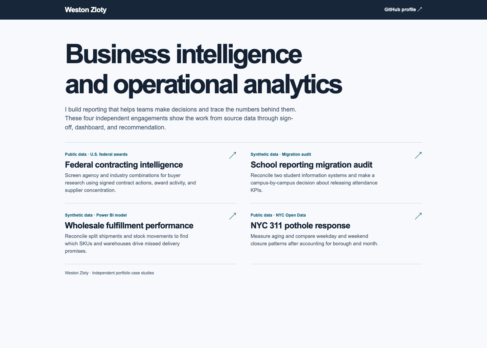

# Weston Zloty | Business intelligence and data analytics

I build reporting systems that help teams make decisions and trace the numbers behind them. My professional work has included executive reporting, KPI governance, data migrations, and dashboard consulting across school and business operations. The four independent case studies below show the underlying technical work and the decisions it supports.

[Open the interactive portfolio](https://avizdatasolutions.github.io/bi-portfolio/) · [Interview guide](INTERVIEW.md) · [Power BI project notes](power-bi/README.md)



| Case study | Decision and delivered evidence | Skills |
|---|---|---|
| [Federal contracting intelligence](projects/federal-contracting/) · Public data | Prioritize buyer research across three agencies. Processed 23,996 contract actions, reconciled signed obligations and tested the shortlist against alternative scoring weights. [Dashboard](https://avizdatasolutions.github.io/bi-portfolio/dashboard.html?case=federal-contracting) | Python API ingestion, signed-dollar SQL, window functions, HHI, sensitivity |
| [School reporting migration audit](projects/school-reporting/) · Synthetic | Decide whether to release an attendance scorecard. Reconciled 72,000 student-days and produced campus sign-off gates and remediation queues. [Dashboard](https://avizdatasolutions.github.io/bi-portfolio/dashboard.html?case=school-reporting) | Data cleaning, identity crosswalks, full outer joins, event deduplication, quality gates |
| [Wholesale fulfillment performance](projects/wholesale-fulfillment/) · Synthetic | Find which SKUs and sites need replenishment review. Reconciled split shipments and daily stock in an editable Power BI project. [Dashboard](https://avizdatasolutions.github.io/bi-portfolio/dashboard.html?case=wholesale-fulfillment) | Multiple fact grains, star schema, Power Query, DAX, snapshot balances |
| [NYC 311 pothole response](projects/nyc-311/) · Public data | Identify a borough for an aged-request review. Evaluated comparable follow-up windows across 77,239 requests and standardized the weekend comparison. [Dashboard](https://avizdatasolutions.github.io/bi-portfolio/dashboard.html?case=nyc-311) | Paginated ETL, timestamp QA, fixed observation windows, stratified analysis |

Every case has a decision brief, source and method documentation, a data dictionary, validation output, a dashboard screenshot, an interactive report, and interview talking points. The two simulations are explicitly labeled and use deterministic fictional records. The case studies are independent work samples. No employer or client data are included.

## Reproduce locally

Python 3.9 or later is required. Use the included public snapshots for the published results.

```bash
python3 -m venv .venv
source .venv/bin/activate
python -m pip install -r requirements.txt
python build.py
python -m http.server 8000 --directory docs
```

Open `http://localhost:8000`. On Windows, activate the environment with `.venv\Scripts\Activate.ps1`. The four reports can also open directly from `docs/index.html` without a local server. The site has no remote runtime dependencies.

The build runs **26 data checks** and regenerates the case evidence, CSVs, browser dashboard payload, and native Power BI files. The default build is offline after installing DuckDB. To replace public snapshots when running a new analysis, use the following commands. These datasets are revised upstream, so refreshed results can differ from the published reports.

```bash
python src/fetch_sources.py federal
python src/fetch_sources.py nyc
python build.py
```

## Work product

- `projects/` holds the four decision briefs, SQL models, source manifests where applicable, data dictionaries, and analytical output.
- `src/` contains the load and analysis logic, seeded generators, and Power BI export.
- `docs/` contains the static interview-ready dashboards and screenshots.
- `power-bi/` contains the editable Power BI report, semantic model and metric smoke query.

The public extracts come from [USAspending.gov](https://www.usaspending.gov/federal-spending-guide) and [NYC Open Data](https://data.cityofnewyork.us/Social-Services/311-Service-Requests-from-2010-to-Present/erm2-nwe9/data). Their scope and retrieval details are recorded with each extract.
