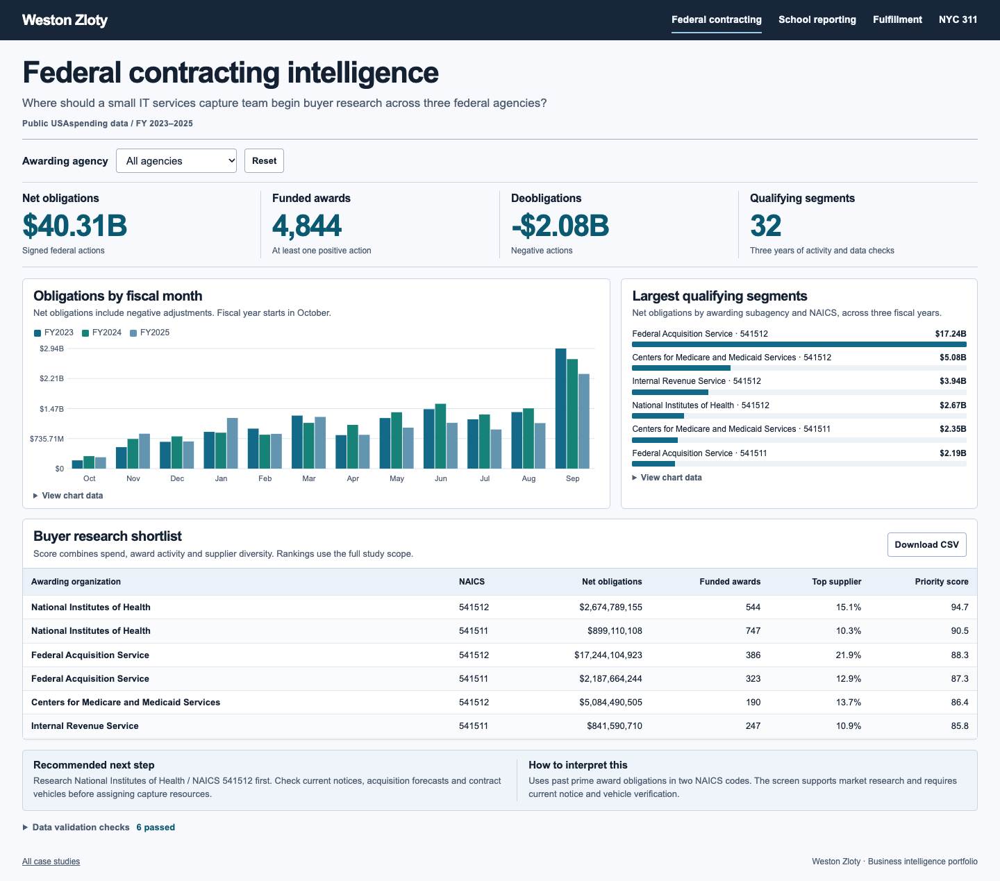
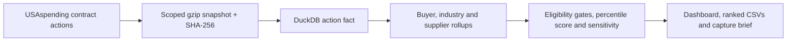

# Federal contracting intelligence

**Independent analysis · Public federal contract data · FY 2023–2025**

A small IT services capture team has time to research only a few federal buyers before its next pipeline review. This case ranks awarding subagency and industry combinations by observed award activity, net obligations, and supplier concentration. It gives the team a starting shortlist and a set of checks to run before committing capture resources.

[Interactive dashboard](https://avizdatasolutions.github.io/bi-portfolio/dashboard.html?case=federal-contracting) · [SQL model](model.sql) · [Python pipeline](../../src/federal.py) · [Evidence and validation](results/evidence.json) · [Source manifest](data/manifest.json)

## Findings and recommendations

- The extract contains **23,996 contract actions** and **4,844 distinct awards with a positive action**, with **$40.31B net obligations** after **$2.08B in deobligations**. Totals cover the three selected awarding departments and two NAICS codes only.
- **National Institutes of Health, NAICS 541512** ranks first at **94.7/100**. The segment shows **$2.67B** in signed net obligations, **544 funded awards**, and a **15.1% top-supplier share** of positive dollars with a known identity. It also ranks first in the two alternative weighting scenarios. [Rank sensitivity](results/rank_sensitivity.csv)
- **GSA Federal Acquisition Service, NAICS 541512** has the largest qualifying net total at **$17.24B** and ranks third under balanced weights. Its rank moves when spend or diversity carries more weight, giving capture leadership a concrete reason to discuss its priorities before choosing a shortlist. [Segment results](results/segments.csv)

**Decision brief for a capture lead.** Start the next buyer-research pass with NIH systems design. Assign a researcher to verify active solicitations, acquisition forecasts, vehicle eligibility, and delivery fit. Keep GSA FAS on the review list and check the mix of task orders and vehicles before estimating an addressable pipeline. Re-run the same screen on a refreshed extract with a documented cut-off.

## Architecture and methods

The scope is HHS, Treasury and GSA as **awarding** agencies, prime award types A through D, and NAICS **541511** (custom computer programming) and **541512** (computer systems design). The action-date interval is October 1, 2022 through September 30, 2025, inclusive. The source is the Treasury contract transaction download. The bundled snapshot records its query, retrieval timestamp and checksum. [USAspending Analyst’s Guide](https://www.usaspending.gov/federal-spending-guide)

One fact row represents one contract action. Sum the signed action amount to measure net obligations. Count unique award keys with at least one positive action in scope to measure funded awards. Compute supplier shares on gross positive obligations so negative amendments do not create negative weights. Resolve identities by UEI, with a normalized name fallback. HHI is the sum of squared known-supplier shares on a 0–1 scale.

Segments qualify with at least 10 funded awards, positive activity in all three fiscal years, positive net obligations, and usable supplier identity on at least 95% of positive dollars. The priority score weights percentile ranks of net obligations, funded awards, and low HHI at 35%, 35%, and 30%. Alternative scenarios shift weight toward spend or diversity. The global ranking stays fixed when the dashboard is filtered to an agency.

## Data dictionary

| Entity and grain | Fields and meaning |
|---|---|
| Source contract action | `contract_transaction_unique_key` unique action key. `contract_award_unique_key` parent award key. `award_id_piid` procurement instrument identifier. `modification_number` action modification identifier. `action_date` date of action. `federal_action_obligation` signed USD. |
| Source classifications | `awarding_agency_name`, `awarding_sub_agency_name` buyer chain. `recipient_uei`, `recipient_name` supplier identity. `naics_code` industry classification. `extent_competed`, `type_of_set_aside` source descriptors retained for follow-up. |
| `fact_action` | Typed action fields with derived `fiscal_year`, `calendar_month`, normalized `supplier`, buyer `agency` and `bureau`, and `net_obligation`. |
| `segments.csv` · agency × bureau × NAICS | `net`, `gross_positive`, `deobligation` signed-dollar rollups. `funded_awards`, `active_years` activity counts. `supplier_count`, `top_supplier_share`, `hhi`, `known_supplier_gross`, `identity_coverage` concentration and coverage. `eligible`, `score` screening fields. |
| `monthly.csv` · agency × month | `fiscal_year`, `month`, `actions`, `net`, `gross_positive`, `deobligation` chronology and signed volume. |
| `rank_sensitivity.csv` · qualifying segment | Identifying fields plus `balanced_score`, `size_weighted_score`, `diversity_weighted_score`. |

## Reproduction and controls

From the repository root, install `requirements.txt` into a Python 3.9+ virtual environment and run `python build.py`. Open the local index at `docs/index.html`. The included extract keeps the published results reproducible. To request a new authoritative snapshot, run `python src/fetch_sources.py federal` before rebuilding.

The pipeline verifies the snapshot checksum and row count, unique action IDs, required keys and amounts, agreed agency, industry and fiscal-year scope, the exact signed-dollar identity, and the bounds on concentration and coverage. Results are recorded in the evidence file.

## Limitations

Historical obligations are reported activity. Addressable incumbent work and current pipeline require follow-up on contract vehicles, acquisition plans, eligibility and timing. A single award can span multiple action dates or classification scopes, so subgroup award counts should never be summed to get a portfolio total. Name fallback can split or merge suppliers and the analysis does not consolidate corporate parents. Dollar amounts are nominal. New snapshots can include amendments to historical actions.

## Portfolio description

Built a reproducible federal contracting intelligence pipeline that turns public prime award actions into a signed-dollar, concentration-aware buyer shortlist with score sensitivity checks.

## Interview walkthrough

1. Explain the difference between action grain, award grain, and buyer–industry grain using one example of a contract modification.
2. Show why signed dollars work for obligations and gross positive dollars work for concentration shares.
3. Compare NIH with GSA FAS and walk through the next research step you would ask a capture lead to authorize.
