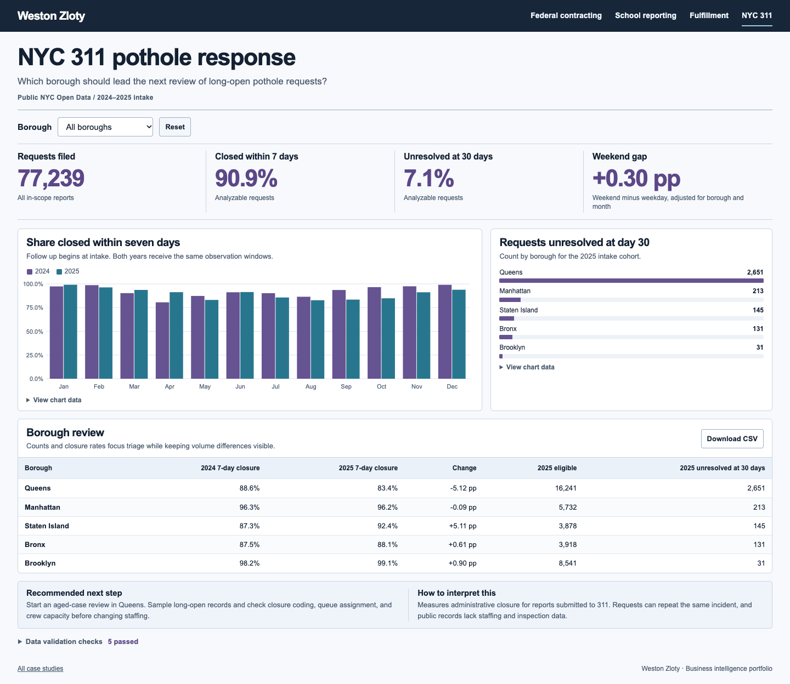
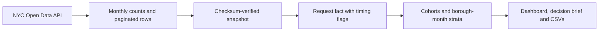

# NYC 311 pothole response

**Independent analysis · Public NYC Open Data · Calendar years 2024 and 2025**

For a weekly street-operations review, the decision is where to begin investigating aged pothole requests. This case compares consistent 7-day and 30-day closure windows across boroughs. It also tests whether a difference between weekend and weekday intake persists after aligning borough and intake-month mix.

[Interactive dashboard](https://avizdatasolutions.github.io/bi-portfolio/dashboard.html?case=nyc-311) · [SQL model](model.sql) · [Python pipeline](../../src/nyc.py) · [Evidence and validation](results/evidence.json) · [Source manifest](data/manifest.json)

## Findings and recommendations

- The snapshot has **77,239** DOT pothole requests. **19** records have a closure earlier than intake and are excluded from timing KPIs. Across the eligible records, **90.85%** closed within seven days and **7.08%** were unresolved at 30 days. [Timing exceptions](results/timing_quality.csv)
- **Queens** has **2,651** requests unresolved after 30 days among **16,241** eligible 2025 requests. Its seven-day rate falls from **88.56%** in 2024 to **83.44%** in 2025, a **5.12 percentage-point** decrease. Queens accounts for about **83.6%** of the 2025 unresolved load across boroughs with a known borough. [Borough evidence](results/borough_year.csv)
- The borough-month adjusted weekend difference is **+0.30 pp** (weekend minus weekday) on **76,973** requests in comparable strata. The crude difference in the same strata is **+0.24 pp**. These averages give limited support for a system-wide weekend disadvantage. [Standardization inputs](results/borough_month_day_group.csv)

**Decision brief for a street-operations lead.** Start a case review in Queens. Sample long-open records by month and verify closure coding, duplicate reports, routing, and the field work status. Track 7- and 30-day closure for a follow-up cohort. Include workload and crew-hours data before using the report to make scheduling decisions.

## Architecture and methods

Scope is DOT, Street Condition, Pothole, with creation between January 1, 2024 and January 1, 2026 (exclusive). The extract requests only needed fields and compares each monthly page count to an independent count query. The report evaluates administrative closure within elapsed local calendar intervals. All intake dates have at least 30 days of follow-up as of February 1, 2026. A request with no close date and a non-closed status remains unresolved. Conflicting or malformed timestamp records are counted in data quality and omitted from rate denominators. [NYC Open Data 311 service requests](https://data.cityofnewyork.us/Social-Services/311-Service-Requests-from-2010-to-Present/erm2-nwe9/data)

The adjusted difference averages within-stratum weekend-minus-weekday rates weighted by the total number of requests in each borough-by-year-month stratum. Retain strata with at least five requests in each day group. Unspecified boroughs remain in citywide counts where eligible, but do not enter the adjustment or borough ranking.

## Data dictionary

| Entity and grain | Fields and meaning |
|---|---|
| Source snapshot · 311 request | `unique_key` public row ID, `created_date`, `closed_date` local timestamps, `status` source label, `borough` reported geography, `descriptor` pothole scope. |
| `fact_request` · 311 request | `request_id`, parsed creation and closure, `has_closure_value`, normalized `status` and `borough`, `intake_year`, `intake_month`, `day_group`, `timing_status`, `closed_7d`, `closed_30d`. |
| `borough_year.csv` · borough × intake year | `eligible_requests`, `closure_7d` proportion, `unresolved_30d` proportion, `unresolved_count`. |
| `borough_month_day_group.csv` · borough × month | `weight` total requests, `n_weekend` and `n_weekday` group sizes, `rate_weekend` and `rate_weekday` 7-day closure proportions. |
| `monthly.csv` · borough × month | `eligible_requests`, `closure_7d`, `unresolved_30d`. |
| `timing_quality.csv` · data quality category | `timing_status` and `requests` count of affected source records. |

## Reproduction and controls

Install `requirements.txt` and run `python build.py` from the repository root. The project uses the included public snapshot. To refresh it, run `python src/fetch_sources.py nyc` before building, then review source changes. Open `docs/index.html` to view the dashboard.

Controls check unique request IDs, raw-to-classified row balance, complete 30-day eligibility, the logical nesting of 7-day and 30-day closures, and borough-level metric reconciliation.

## Limitations

311 reports depend on reporting behavior and can repeat a physical issue. Administrative closure is a recorded process event. The source does not provide complete repair verification, crew staffing, or a history of intermediate or reopened statuses. Current extracts can revise past records. The adjustment addresses borough and month composition, while unmeasured queue and case differences remain.

## Portfolio description

Analyzed 77,239 public NYC 311 pothole requests using fixed follow-up windows, timestamp quality controls and borough-month standardization to focus a long-open case review.

## Interview walkthrough

1. Explain why a fixed intake cohort and equal follow-up intervals matter for comparing closure rates.
2. Walk through the 19 invalid timestamps and the difference between excluding invalid records and treating open requests as unresolved.
3. Show how the borough-month adjustment changes the weekend question and what additional information a staffing decision needs.
