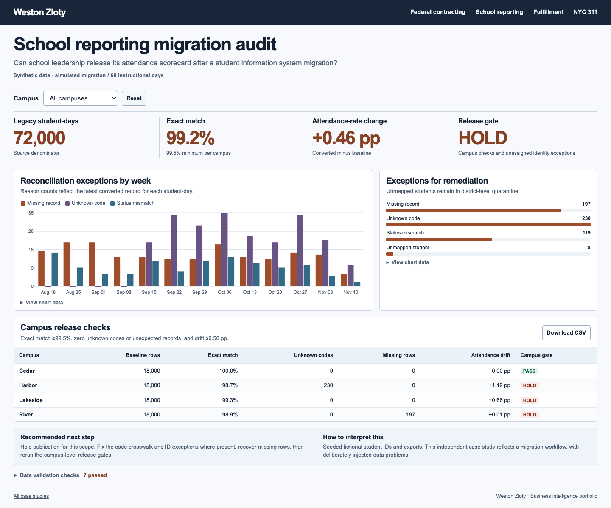
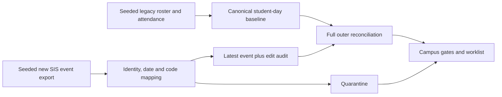

# School reporting migration audit

**Independent case study · Synthetic data · Simulated school system migration**

A school leadership team needs to decide whether its attendance scorecard can go live after a student information system migration. A district-level attendance average can hide failures in a single campus. This audit reconciles the two source systems at student-day grain and gives the registrar and reporting owner a clear release decision.

[Interactive dashboard](https://avizdatasolutions.github.io/bi-portfolio/dashboard.html?case=school-reporting) · [SQL model](model.sql) · [Python generator and pipeline](../../src/school.py) · [Evidence and validation](results/evidence.json)

## Findings and recommendations

- The synthetic legacy system has **72,000 student-days**. The migrated export has **71,454 exact matches (99.24%)**, with **230 unknown codes, 197 missing student-days, and 119 status mismatches**. Eight additional events lack a student mapping and stay in district-level quarantine.
- Simulated district attendance increased from **91.85% to 92.32%**, a **+0.46 percentage-point** shift. The district average obscures **Harbor's +1.19 pp** and **Lakeside's +0.66 pp** differences. Cedar is the only campus that meets the campus thresholds. [Campus reconciliation](results/campus_signoff.csv)
- Harbor has an inbound excused-absence alias missing from the crosswalk. River's main issue is missing rows despite a small rate change. Lakeside has known-code disagreements, concentrated in absence-to-present conversion. These failure modes require different fixes. [Exceptions](results/exceptions.csv) · [Quarantine](results/quarantine.csv)

**Decision brief for a registrar and reporting owner.** Hold the district board scorecard. Have the registrar verify the meaning of Harbor's alias and approve the code map. Re-export River's missing dates and investigate the Lakeside transformation rule. Assign and resolve the eight identity exceptions. Preserve Cedar as a candidate for a scoped release after rerunning the final cutover extract and checking the edit audit trail.

## Architecture and methods

The fictional setup uses 1,200 students across four campuses and 60 instructional days. Seed `36481` makes the data repeatable. Two calendar holidays are omitted. Present and tardy count as attendance, and both excused and unexcused absences count as absent. The latest source update wins per student and date, with the row ID as a deterministic tie-break. A conflict flag preserves earlier discrepancies for review. The exact match denominator includes all legacy student-days. The converted attendance rate uses recognized converted records, so missing or unknown rows can shift the reported rate.

Campus release requires at least **99.5%** exact match, no unknown codes or unexpected student-days, and no more than **0.50 pp** absolute attendance drift. The district gate also requires zero unassigned identity exceptions. Earlier conflicting source states are reviewed separately because they can represent legitimate corrections. The checks and thresholds are designed for this simulation.

## Data dictionary

| Entity and grain | Fields and meaning |
|---|---|
| `instruction_day` · scheduled day | `instruction_date` local instructional date. |
| `dim_student` · synthetic student | `student_id` old system stable identifier, `campus` fictional campus, `grade` grade 9–12. |
| `student_crosswalk` · migrated ID | `new_id` target ID, `student_id` legacy identifier. |
| `code_crosswalk` · source code | `new_code` export value, `canonical_status` normalized Present/Tardy/Absent. |
| `legacy_export` · student-day | `student_id`, `instruction_date`, `attendance_code`, `canonical_status`. |
| `new_export` · attendance event | `row_id` unique event key, `new_id`, `instruction_date`, `attendance_code`, `updated_at` priority timestamp. |
| `exceptions.csv` · student-day | Identifiers, campus and grade. `expected_status`, `observed_status`, `new_raw_code`, `new_row_count`, `conflicting_edits`, `outcome` track the comparison. |
| `quarantine.csv` · invalid event | Raw event fields plus `issue`. Unknown-code rows can also appear in student-day reconciliation, so avoid summing across the two queues. |
| `campus_signoff.csv` · campus | Baseline and matches, counts by exception type, conflicting edits, baseline and converted rates, match rate, attendance delta, and `campus_pass`. |
| `weekly_status.csv` · campus × week × outcome | `campus`, `week`, `outcome`, `records` for trend review. |

## Reproduction and controls

Install `requirements.txt` and run `python build.py` from the repository root. The generator rebuilds source tables from the seed without accessing an external student record. Open `docs/index.html` for dashboard navigation.

The pipeline verifies the complete legacy student-day population, one-to-one student ID crosswalk, unique event IDs, exhaustiveness of source routing, unique reconciled grain and exact reason totals. It also requires all three intentionally injected discrepancy scenarios to appear. A passing pipeline and a HOLD business gate are both expected.

## Limitations

The scenario is synthetic and uses an assumed reference extract. It illustrates migration acceptance with historical snapshots. A live deployment would also require registrar-approved mappings, enrollment effective dates, an accommodations and partial-day policy, operator sign-off, access controls, and a rollback plan. The project reports no school performance outcomes.

## Portfolio description

Built a migration audit that reconciles 72,000 synthetic student-days across two SIS exports and turns campus-level discrepancies into explicit release gates and remediation queues.

## Interview walkthrough

1. Draw the full outer join and explain what would disappear in an inner join.
2. Show why a district average can pass while campus metrics drift and walk through Harbor and River.
3. Explain how event ordering, quarantine, and registrar sign-off let you defend the final number.
