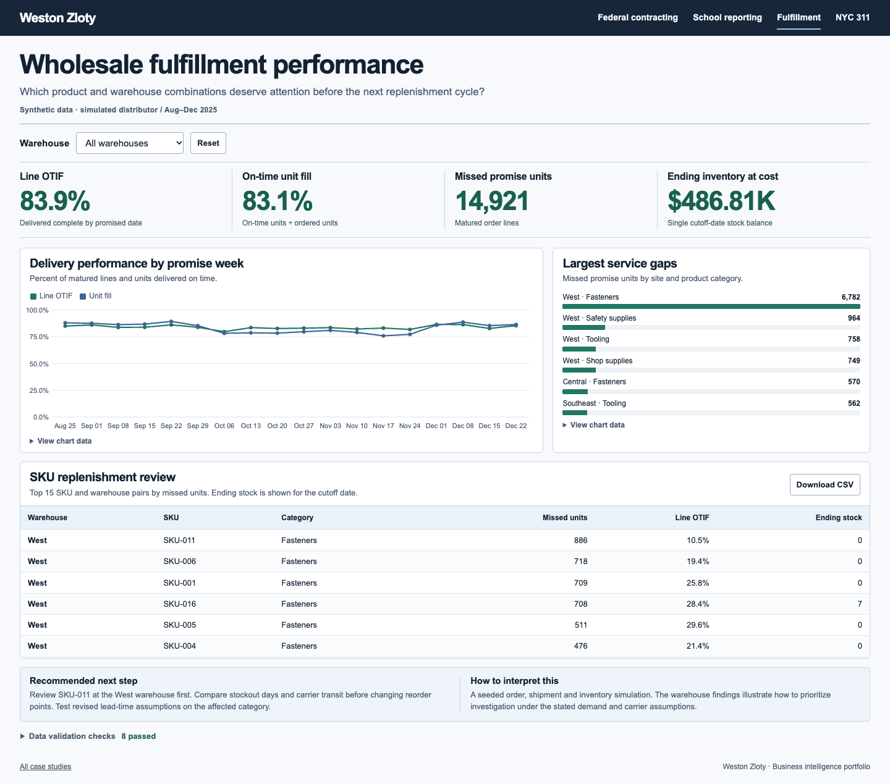
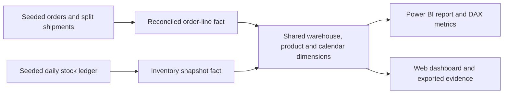

# Wholesale fulfillment performance

**Independent case study · Synthetic data · Simulated distributor · Editable Power BI project**

An operations team sees anecdotes about late deliveries but has three source systems that count orders, shipments, and stock differently. The replenishment manager needs to identify where service misses accumulate and how much stock is available at the cutoff. This project reconciles the three grains and builds a dimensional semantic model that leadership and planners can use from the same report.

[Interactive dashboard](https://avizdatasolutions.github.io/bi-portfolio/dashboard.html?case=wholesale-fulfillment) · [Power BI project](../../power-bi/Fulfillment.pbip) · [SQL model](model.sql) · [Python generator and pipeline](../../src/wholesale.py) · [Evidence and validation](results/evidence.json)

## Findings and recommendations

- The simulated distributor delivers **83.95%** of **11,218 matured order lines** complete and on time. The unit-weighted metric is **83.07%**. The report records **14,921 missed promise units** and excludes **143 lines whose promise dates are beyond the cutoff**. [Site service](results/site_service.csv)
- **West** has **68.52% line OTIF** and accounts for **9,253 missed units (62.0%)**. West Fasteners accounts for **6,782 units**, or **45.5% of the network's misses**, under the planted demand and lead-time conditions. [SKU and warehouse service](results/sku_service.csv)
- **West SKU-011** accounts for **886 missed units** and ends with **zero on-hand units**. Network inventory at the December 28 cutoff is **$486,809.92 at cost**. The point-in-time value is the sum of balances for that day, rather than an accumulation over days. [Ending inventory records](results/final_inventory.csv)

**Decision brief for a replenishment manager.** Start with a West Fasteners review and compare stockout days and carrier transit on the five highest-miss SKUs. In the simulated workflow, replay candidate lead times and safety stock rules before changing purchase parameters. Track service and stock value together. Use promise-week cohorts to check whether improvements persist.

## Architecture and methods

The fixture simulates 64 SKUs, four warehouses, 126 operating dates, staged replenishment and split shipments. Seed `50918` fixes the order and dispatch streams. Promise date determines service cohorts. The analysis evaluates only lines due by December 28, 2025. A line is OTIF when every ordered unit reaches the customer by its promise date. The on-time unit fill denominator is ordered units on matured lines. Closing inventory equals opening units plus receipts minus units shipped. Ending balance measures use the latest inventory date in scope.

The Power BI semantic model contains three conformed dimensions and two facts with six single-direction relationships. The calendar filters promise dates in Order Lines and inventory dates in Inventory. DAX calculates `Line OTIF`, `On Time Unit Fill`, `Missed Promise Units`, week-over-week changes, and point-in-time inventory. The report uses warehouse and category slicers. The Power Query import embeds a compressed, typed extract generated from the reconciled model, so it needs neither a password nor a file path adjustment.

## Data dictionary

| Entity and grain | Fields and meaning |
|---|---|
| `dim_product` · SKU | `sku` fictional item ID, `category` rollup, `unit_cost` synthetic USD per unit. |
| `dim_site` · warehouse | `site` region label. |
| `raw_order` · order line | `line_id`, `ordered_on`, `promised_on`, `site`, `sku`, `ordered_units`. |
| `raw_shipment` · line shipment event | `shipment_id`, `line_id`, `shipped_on`, `delivered_on`, `units`. |
| `fact_order_line` · line | Source order fields plus `matured`, `shipped_units`, `on_time_units`, `otif`, `missed_units`. A missing service deficit identifies a line without full observation. |
| `fact_inventory` · day × warehouse × SKU | `inventory_date`, `site`, `sku`, `opening_units`, `receipt_units`, `shipped_units`, `closing_units`, `closing_inventory_value`. |
| Power BI `Calendar` · calendar day | `Date` unique contiguous dates and `Week Beginning` Monday cohort label. |
| `site_service.csv` / `weekly_service.csv` | Rolled up order-line service counts, fulfilled units, demand units and rate or week depending on the output. |
| `sku_service.csv` · SKU × warehouse | Service counts, `otif`, category, ending stock, costing assumptions, and `missed_order_cost_basis` (missed units × cost, an exposure proxy). |

## Reproduction and controls

Install `requirements.txt` and run `python build.py` from the repository root. This regenerates the report files and exports from the seed. Open `docs/index.html` in a browser. For the native report, open `power-bi/Fulfillment.pbip` in a current Power BI Desktop on Windows and select Refresh to load the embedded partition data. The [Power BI notes](../../power-bi/README.md) include verification and troubleshooting details.

Checks cover order and shipment keys, shipment chronology, delivered-unit bounds, expected day-by-site-by-SKU coverage, inventory rollforward, prior-day close continuity, stock-versus-shipment reconciliation, and the eligible OTIF denominator.

## Limitations

The synthetic simulation uses fixed cost per SKU, calendar-day promises, no returns or cancellations, and an injected West demand and transit pattern. The reported findings demonstrate the analytical workflow. A regional service gap alone does not establish carrier performance or justify an inventory investment. The next step is to validate candidate drivers and model changes with operations data.

## Portfolio description

Built a two-fact Power BI semantic model that reconciles split shipments and daily stock and identifies where delivery misses concentrate in a simulated distributor.

## Interview walkthrough

1. Explain why shipment rows and inventory dates cannot be joined directly to order lines without changing fact grain.
2. Show why 83.95% line OTIF and 83.07% unit fill describe different exposure. Explain the cutoff and denominator.
3. Explain the latest-date DAX logic for inventory, then name the operational evidence you would need before changing stock policy.
